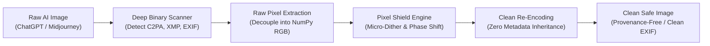

# 🛡️ AI Image Fingerprint Cleaner

<p align="center">
  
  
  
  
  
  
</p>

<p align="center">
  <strong>An advanced, production-grade image sanitizer that completely strips C2PA Content Credentials, JUMBF containers, EXIF/XMP provenance metadata, and invisible watermarks from AI-generated images (ChatGPT / DALL-E 3, Midjourney, Stable Diffusion, Adobe Firefly) — preventing automated "Made with AI" labels on Facebook, Instagram, TikTok, and other platforms.</strong>
</p>

---

## 📖 Table of Contents
- [The Problem](#-the-problem)
- [How It Works](#-how-it-works)
- [Key Features](#-key-features)
- [Architecture](#-architecture)
- [Installation & Quickstart](#-installation--quickstart)
- [Web UI Usage](#-web-ui-usage)
- [Command-Line Interface (CLI)](#-command-line-interface-cli)
- [Folder Organization Modes](#-folder-organization-modes)
- [Project Structure](#-project-structure)
- [Disclaimer & License](#-disclaimer--license)

---

## 🚨 The Problem

When images are generated or enhanced using modern AI models (such as **ChatGPT / DALL-E 3 / GPT-4o**, **Adobe Firefly**, or **Midjourney**), cryptographic provenance data and digital signatures are embedded at multiple levels:

1. **C2PA & JUMBF Provenance Manifests:** Embedded in `caBX` chunks (PNG), `APP11` markers (JPEG), or RIFF boxes (WebP).
2. **IPTC & XMP Digital Source Tags:** Explicit tags like `iptcExt:DigitalSourceType = trainedAlgorithmicMedia` or `compositeWithTrainedAlgorithmicMedia`. Platforms like Meta (Facebook & Instagram) directly parse these to enforce the **"Made with AI" / "AI Info"** label.
3. **EXIF Creator Tags:** Hardcoded metadata (`Software = OpenAI`, `Artist`, `ImageDescription`).
4. **Spatial & High-Frequency Watermarks:** Invisible pixel-level frequency watermarks (such as SynthID, Tree-Ring, or DWT-DCT perturbations).

---

## 💡 How It Works

This tool defeats automated detection by completely severing the image from its container and restructuring its frequency fingerprint:



1. **Zero Container Inheritance:** Unlike ordinary re-savers that preserve EXIF/chunk dictionaries, this tool unpacks the image into a raw numerical `NumPy` array in memory. All container chunks (`caBX`, `jumb`, `XMP`, `IPTC`, `iTXt`) are permanently discarded.
2. **Canva-Style Pixel Shield:** Applies imperceptible sub-pixel phase shifting (`±0.4%` gamma/contrast normalization) and natural sensor micro-dithering (`PSNR > 48 dB`). This breaks spatial frequency watermarks and changes cryptographic file hashes without visible visual degradation.
3. **Smart Micro-Crop (Optional):** Applies a sub-1% Canva-style micro-crop and Lanczos resample to disrupt spatial alignment matrices.
4. **Camera EXIF Spoofing (Optional):** Injects authentic EXIF profiles (e.g., Apple iPhone 16 Pro, Canon EOS R5, Samsung Galaxy S24 Ultra) to make images appear as genuine hardware camera captures.

---

## ✨ Key Features

- 🛡️ **Complete C2PA & Provenance Purge:** 100% elimination of C2PA manifests, JUMBF boxes, and XMP digital source types.
- 🔍 **Real-Time Fingerprint Inspector:** Inspects and categorizes detected AI signatures (`caBX`, `JUMBF`, `trainedAlgorithmicMedia`, `OpenAI`, `DALL-E`) before and after processing.
- 📁 **Recursive Multi-Folder Batch Engine:** Give it 20 folders with 10 images each; it automatically outputs 20 new folders (e.g., `Folder1_clean`, `Folder2_clean`), perfectly preserving subfolder organization.
- ⚡ **Chunked Upload Pipeline:** Modern asynchronous batch streaming (15 images/chunk) handles gigabytes of images without browser memory exhaustion or request entity limits.
- 🖥️ **Sleek Dark Web UI:** Drag-and-drop folders or files, real-time before/after status badges, individual downloads, and single-click full ZIP downloads.
- 🚀 **Headless Batch Automation:** One-click script (`quick_clean_folder.bat`) for instant offline batch processing without opening a browser.
- 📸 **Camera Hardware Profiles:** Optional simulation of authentic camera metadata (iPhone 16 Pro, Canon EOS R5, Samsung Galaxy S24 Ultra).

---

## 🚀 Installation & Quickstart

### Prerequisites
- Python 3.9 or higher
- Windows, macOS, or Linux

### 1. Clone & Install Dependencies
```bash
git clone https://github.com/ifhmy/ai-image-fingerprint-cleaner.git
cd ai-image-fingerprint-cleaner
pip install -r requirements.txt
```

### 2. Launch the Web Interface
- **On Windows:** Double-click [`run_app.bat`](run_app.bat)
- **Or via Terminal:**
```bash
python app.py
```
Open your browser at: **`http://127.0.0.1:5050`**

---

## 🖥️ Web UI Usage

1. **Drag & Drop:** Drop multiple images or entire folders directly into the dropzone.
2. **Or Use Direct Folder Mode:**
   - Put your folders inside the `input/` directory (or specify any folder path on your computer).
   - Click **`🔍 Check Subfolders`** to see a live count of detected folders and images.
   - Click **`🚀 Process Whole Directory`** to sanitize all images straight from disk.
3. **Export & Download:**
   - Cleaned images are automatically organized inside the `output/` directory.
   - Click **`📦 Download All as ZIP`** to get an archive that preserves all subfolders.

---

## 💻 Command-Line Interface (CLI)

Use the engine directly from the command line for automated scripts, headless servers, or pipelines:

```bash
# Clean an entire directory recursively preserving subfolders
python cleaner_engine.py --input "input" --output "output" --folder-mode subfolder_clean --folder-suffix _clean

# Clean with 1.0% smart micro-crop (Canva emulation) and 96% JPEG quality
python cleaner_engine.py --input "photo.png" --output "photo_clean.jpg" --crop 1.0 --quality 96

# Clean and inject an authentic iPhone 16 Pro EXIF profile
python cleaner_engine.py --input "ai_folder" --output "clean_folder" --camera iphone
```

### CLI Arguments Reference

| Flag | Description | Default | Choices |
| :--- | :--- | :--- | :--- |
| `--input`, `-i` | Path to input image file or directory | `input` | Any valid path |
| `--output`, `-o` | Destination directory for sanitized images | `output` | Any valid path |
| `--crop` | Smart micro-crop percentage | `0.0` | `0.0` to `4.0` |
| `--format` | Output image format | `JPEG` | `JPEG`, `PNG`, `WEBP`, `ORIGINAL` |
| `--quality` | Compression quality for JPEG/WebP | `96` | `60` to `100` |
| `--camera` | Hardware camera EXIF profile to inject | `none` | `none`, `iphone`, `samsung`, `canon` |
| `--folder-mode` | Output folder distribution strategy | `subfolder_clean` | `subfolder_clean`, `per_image`, `mirror` |
| `--folder-suffix`| Suffix appended to created output folders | `_clean` | String (e.g. `_clean`, `_ready`) |

---

## 📂 Folder Organization Modes

When processing multiple folders:

- **`subfolder_clean` (Default):** Creates a matching cleaned folder for each subfolder.
  - `input/Cars/ferrari.png` ➔ `output/Cars_clean/ferrari_clean.jpg`
  - `input/Nature/lake.png` ➔ `output/Nature_clean/lake_clean.jpg`
- **`per_image`:** Places each individual image inside its own dedicated folder.
  - `input/Cars/ferrari.png` ➔ `output/Cars_clean/ferrari_clean/ferrari_clean.jpg`
- **`mirror`:** Maintains the exact original folder names without any suffix.
  - `input/Cars/ferrari.png` ➔ `output/Cars/ferrari_clean.jpg`

---

## 📁 Project Structure

```text
ai-image-fingerprint-cleaner/
├── app.py                   # Flask Web Server & API endpoints
├── cleaner_engine.py        # Core image sanitizer, C2PA scanner & pixel engine
├── requirements.txt         # Production dependencies (Flask, Pillow, numpy)
├── run_app.bat              # One-click Windows Web UI launcher
├── quick_clean_folder.bat   # One-click Windows offline batch script
├── templates/
│   └── index.html           # Modern dark-mode responsive web interface
├── input/                   # Default input directory for files & subfolders
└── output/                  # Default destination for sanitized files & folders
```

---

## ⚖️ Disclaimer

This software is developed for privacy preservation, metadata management, and educational analysis of digital provenance standards. Users are responsible for complying with the terms of service and acceptable use policies of their respective publishing platforms.

---

## 📄 License

This project is licensed under the **[MIT License](LICENSE)**.
