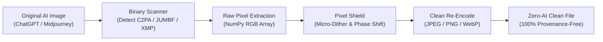

# 🛡️ AI Image Fingerprint Cleaner & Metadata Stripper

<p align="center">
  
  
  
  
  
</p>

<p align="center">
  <strong>أداة متقدمة لتنظيف وإزالة بصمات الذكاء الاصطناعي (C2PA / JUMBF / EXIF / XMP) وإعادة بناء الصور بالكامل لمنع تصنيفها على منصات التواصل الاجتماعي (Facebook, Instagram, TikTok).</strong>
  <br />
  <em>Advanced tool to completely purge AI watermarks, C2PA manifests, and provenance metadata from images, preventing automatic "Made with AI" labels on social media.</em>
</p>

---

## 📌 المشكلة والحل (The Problem & Solution)

### 🚨 لماذا يكتشف فيسبوك والسوشيال ميديا صور الذكاء الاصطناعي؟
عند توليد أو تحسين الصور عبر **ChatGPT (DALL-E 3 / GPT-4o)** أو **Adobe Firefly** أو **Midjourney**، يتم تضمين بصمات رقمية متعددة المستويات:
1. **بصمة C2PA و JUMBF المشفرة:** حاويات بيانات مدمجة داخل قطاعات `caBX` في ملفات PNG أو علامة `APP11` في JPEG أو `C2PA` في WebP.
2. **وسم المصدر الرقمي IPTC / XMP:** وسم `trainedAlgorithmicMedia` أو `compositeWithTrainedAlgorithmicMedia` الذي تقرأه منصات Meta تلقائياً وتضع شارة **"Made with AI"**.
3. **بيانات EXIF والبرنامج المنشئ:** وسوم واضحة باسم OpenAI أو برامج التصميم التوليدي.
4. **بصمات التردد والبكسل الخفية (Invisible Pixel Watermarks):** علامات عالية التردد في مصفوفة البكسل.

### 🛡️ كيف تحل هذه الأداة المشكلة؟
* **إعادة البناء من الصفر (Zero Metadata Inheritance):** تفكيك الصورة بالكامل إلى مصفوفة بكسل خام (`Raw NumPy RGB Buffer`)، وتجاهل ملف الحاوية بالكامل؛ مما يضمن استحالة انتقال أي قطاع بيانات C2PA أو XMP أو وسم مخفي.
* **محاكاة معالجة Canva الذكية (Canva-Style Shield):** تطبيق تعديل مجهري غير مرئي للبكسل (`LSB Micro-dither`) واقتصاص ذكي طفيف (1%) لكسر التوافق الترددي للبصمة المكانية.
* **تصدير نظيف أو بهوية كاميرا حقيقية:** حفظ الصورة بترميز جديد نقي مع إمكانية حقن بيانات كاميرا حقيقية (مثل iPhone 16 Pro أو Canon EOS R5) لزيادة الموثوقية.

---

## ✨ المميزات الرئيسية (Key Features)

* 🔍 **فاحص ومحلل البصمات المدمج (Built-in AI Fingerprint Inspector):** فحص دقيق قبل وبعد التنظيف لاكتشاف وتحديد وسوم `caBX`، `JUMBF`، `trainedAlgorithmicMedia`، وتوقيعات `OpenAI`.
* 📁 **دعم المجلدات المتعددة والهيكل الشجري (Multi-Folder Batch Processing):** إذا كان لديك 20 مجلداً كل مجلد يحمل 10 صور، يقوم السكربت بمعالجتها جميعاً وتصدير كل مجموعة داخل مجلد مستقل جديد (مثل `Folder1_clean`، `Folder2_clean`).
* ⚡ **نظام المعالجة على دفعات (Chunked Streaming Pipeline):** يعالج مئات الصور والملفات الضخمة بدون أي انهيار أو استهلاك مفرط للذاكرة.
* 🖥️ **واجهة ويب عصرية وتفاعلية (Modern Web UI):** سحب وإفلات الفولدرات، معاينة حية قبل وبعد، ودعم تنزيل الكل بملف مضغوط `ZIP` يحتفظ بهيكل المجلدات.
* 🚀 **معالجة سريعة بضغطة زر (Headless Batch):** ملف تشغيل فوري بدون فتح المتصفح (`quick_clean_folder.bat`).
* 📸 **هوية كاميرا اختيارية (Camera EXIF Spoofing):**
  * بدون أي بيانات (نقية 100%).
  * Apple iPhone 16 Pro.
  * Samsung Galaxy S24 Ultra.
  * Canon EOS R5.

---

## 🏗️ آلية العمل (Architecture Flow)



---

## 🚀 التثبيت والتشغيل (Quickstart)

### المتطلبات (Prerequisites)
* نظام تشغيل: Windows أو macOS أو Linux.
* تثبيت Python 3.9 أو أحدث.

### 1. استنساخ المشروع وتثبيت المتطلبات
```bash
git clone https://github.com/USERNAME/REPO_NAME.git
cd REPO_NAME
pip install -r requirements.txt
```

### 2. تشغيل الواجهة الرسومية (Web UI)
* **على ويندوز:** اضغط مرتين على ملف **`run_app.bat`**
* **أو عبر سطر الأوامر:**
```bash
python app.py
```
ثم افتح المتصفح على الرابط: `http://127.0.0.1:5050`

---

## 💻 الاستخدام عبر سطر الأوامر (CLI Usage)

يمكنك استخدام محرك التنظيف مباشرة من سطر الأوامر أو ضمن سكربتاتك البرمجية:

```bash
# تنظيف مجلد كامل مع الحفاظ على المجلدات الفرعية
python cleaner_engine.py --input "path/to/input" --output "path/to/output" --folder-mode subfolder_clean --folder-suffix _clean

# تنظيف مع اقتصاص ذكي 1% (محاكاة Canva) وجودة عالية 96%
python cleaner_engine.py --input "image.png" --output "clean.jpg" --crop 1.0 --format JPEG --quality 96

# إضافة بيانات كاميرا iPhone 16 Pro
python cleaner_engine.py --input "images_dir" --output "output_dir" --camera iphone
```

### خيارات سطر الأوامر (CLI Arguments):
| المعامل | الوصف | الافتراضي |
| :--- | :--- | :--- |
| `--input` / `-i` | مسار ملف الصورة أو مجلد الإدخال | `input` |
| `--output` / `-o` | مجلد حفظ الصور المعالجة | `output` |
| `--crop` | نسبة الاقتصاص الطفيف (0.0 إلى 4.0%) | `0.0` |
| `--format` | صيغة الإخراج (`JPEG`, `PNG`, `WEBP`, `ORIGINAL`) | `JPEG` |
| `--quality` | جودة الصورة (60 إلى 100) | `96` |
| `--camera` | بيانات الكاميرا (`none`, `iphone`, `samsung`, `canon`) | `none` |
| `--folder-mode` | نظام المجلدات (`subfolder_clean`, `per_image`, `mirror`) | `subfolder_clean` |
| `--folder-suffix` | اللاحقة المضافة لاسم المجلد الجديد | `_clean` |

---

## 📂 هيكل المشروع (Project Structure)

```text
├── app.py                   # تطبيق الويب المحلي (Flask Web Server)
├── cleaner_engine.py        # المحرك الأساسي لإزالة البيانات وإعادة بناء البكسل
├── requirements.txt         # المكتبات المطلوبة (Flask, Pillow, numpy)
├── run_app.bat              # تشغيل الواجهة الرسومية بضغطة زر على ويندوز
├── quick_clean_folder.bat   # تنظيف سريع ومباشر لمجلد input بضغطة زر
├── templates/
│   └── index.html           # واجهة الويب التفاعلية (HTML5 / Modern Dark RTL UI)
├── input/                   # مجلد الإدخال للصور والمجلدات
└── output/                  # مجلد الإخراج للنتائج النظيفة
```

---

## ⚖️ إخلاء مسؤولية (Disclaimer)

هذه الأداة مصممة لأغراض حماية الخصوصية، وإدارة البيانات الوصفية للمصممين وصناع المحتوى، والتحكم في بيانات الصور الشخصية. يرجى استخدامها وفقاً لسياسات المنصات والقوانين المعمول بها.

---

## 📄 الترخيص (License)
هذا المشروع مرخص تحت رخصة **[MIT](LICENSE)**.
